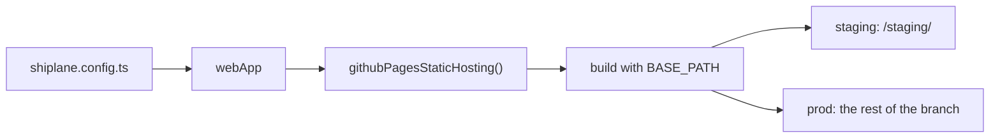

# 🔌 @shiplane/github-pages

Ships a static site to GitHub Pages: fills
[shiplane](https://github.com/arnaud-zg/packages/blob/main/packages/shiplane/README.md)'s **static
hosting** port. Each environment has its own folder on one branch, users' the rest, and none removes
another.



## ⚡ Install

```sh
pnpm add -D shiplane @shiplane/github-pages
```

Then, once, after the first ship: **Settings › Pages › Deploy from a branch**, `gh-pages`,
`/ (root)`.

## ⚙️ Configure

Give the adapter to `webApp`. From [`examples/shiplane.config.ts`](./examples/shiplane.config.ts):

```ts
import { changesetsVersioning } from "@shiplane/changesets";
import { gitSourceControl } from "@shiplane/git";
import { gitHubActionsCiPipeline, gitHubCodeHost } from "@shiplane/github";
import { githubPagesStaticHosting } from "@shiplane/github-pages";
import { defineRelease, releaseFlow, webApp } from "shiplane";

export default defineRelease({
  flow: releaseFlow({
    sourceControl: gitSourceControl(),
    codeHost: gitHubCodeHost(),
    ciPipeline: gitHubActionsCiPipeline(),
    versioning: changesetsVersioning(),
  }),
  deployApps: { promote: [{ from: "staging", to: "prod" }] },
  modules: [webApp({ staticHosting: githubPagesStaticHosting() })],
});
```

Or in a `shiplane.yml`:

```yaml
modules:
  - use: web-app
    with:
      staticHosting: github-pages
```

## 📋 Unit file keys

In the site's `shiplane.unit.yml`, next to `module: web-app`. The same file in both modes.

| Key         | Default    | Means                                                                    |
| ----------- | ---------- | ------------------------------------------------------------------------ |
| `url`       | required   | The site's address; its path is given to the build as `BASE_PATH`        |
| `branch`    | `gh-pages` | The branch Pages serves                                                  |
| `dist`      | `dist`     | What the build writes, relative to the unit's folder                     |
| `domain`    |            | A custom domain, written as `CNAME`                                      |
| `env`       |            | Variables the build reads, each per environment                          |
| `variables` | `[]`       | Names the build reads from your shell or, on CI, from GitHub's variables |

Source: `GithubPagesOptions` in `src/github-pages-static-hosting.adapter.ts`.

## 🧪 Example

From [`examples/apps/site/shiplane.unit.yml`](./examples/apps/site/shiplane.unit.yml):

```yaml
module: web-app
url: https://acme.github.io/acme/
```

`pnpm shiplane ship --dry-run` in that repository prints what a ship to staging would run:

```text
  Plan  ·  staging  · nothing runs
  Order  1 site · Latest

  site@1.0.0 → https://acme.github.io/acme/staging/ (GitHub Pages)  (not tagged yet: release first)
    this machine
      BASE_PATH=/acme/staging/ pnpm --filter=@acme/site run build
      sh -c [ -z "$GITHUB_ACTIONS" ] || { git config --global user.name "github-actions[bot]" && git config --global user.email "41898282+github-actions[bot]@users.noreply.github.com" && git config --global credential.https://github.com.helper "!gh auth git-credential"; } && { git ls-remote --exit-code --heads origin "$1" >/dev/null || git push origin "$(git commit-tree 4b825dc642cb6eb9a060e54bf8d69288fbee4904 -m "start $1")":"refs/heads/$1"; } sh gh-pages
      npx --yes gh-pages@6.3.0 --dist=apps/site/dist --branch=gh-pages --message=site@1.0.0 --dotfiles --nojekyll --dest=staging
      sh -c [ -z "$GITHUB_ACTIONS" ] || gh api -X POST "repos/$GITHUB_REPOSITORY/pages/builds" --silent || echo "Pages was not asked to build: ship again, or build it from Settings > Pages"
      then record site@1.0.0 on staging, on GitHub
    GitHub Actions
      gh workflow run ship.yml --ref site@1.0.0 -f units=site -f environment=staging
```

## 📏 Rules

| Case                            | What happens                                                           |
| ------------------------------- | ---------------------------------------------------------------------- |
| Base path                       | Read `BASE_PATH` in the build, such as Astro's `base` or Vite's `base` |
| `.nojekyll`                     | Always written: a built site needs no Jekyll                           |
| `CNAME`                         | Kept when no `domain` is named                                         |
| The branch does not exist       | Created empty, so the source is never published                        |
| The branch holds the source     | Refused                                                                |
| Someone pushed at the same time | The push is refused, never forced: ship again                          |
| CI                              | Ships through shiplane's workflow, which then asks Pages to build      |

Staging is public, and shares prod's origin.

## 🔑 Tools and sign-ins

On your machine, whatever lets `git push` reach the repository. On CI, the workflow's own token,
with `contents: write` and `pages: write`, which setup writes in `ship.yml`. `npx` fetches
[gh-pages](https://github.com/tschaub/gh-pages), pinned.

## 📚 Docs

- 🔌 **[Plugins](https://github.com/arnaud-zg/packages/blob/main/docs/shiplane/plugins.md)**: how
  shiplane plugins work, and how to write one
- 🚢 **[shiplane](https://github.com/arnaud-zg/packages/blob/main/packages/shiplane/README.md)**:
  the release tool this plugin fills a port of
- 🛠️ **[How-to](https://github.com/arnaud-zg/packages/blob/main/docs/shiplane/how-to.md)**: add an
  app, promote
- 📖 **[Reference](https://github.com/arnaud-zg/packages/blob/main/docs/shiplane/reference.md)**:
  commands, flags, the config and unit files

## 📈 Downloads

<a href="https://npm-stat.com/charts.html?package=@shiplane/github-pages">
  <picture>
    <source media="(prefers-color-scheme: dark)" srcset="https://shieldcn.dev/chart/npm/@shiplane/github-pages.svg?days=90&logo=false&mode=dark" />
    
  </picture>
</a>
