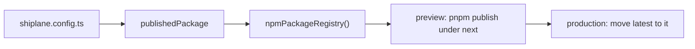

# 🔌 @shiplane/npm

Publishes a package to npm: fills
[shiplane](https://github.com/arnaud-zg/packages/blob/main/packages/shiplane/README.md)'s **package
registry** port with `pnpm publish` and `npm dist-tag`.



## ⚡ Install

```sh
pnpm add -D shiplane @shiplane/npm
```

## ⚙️ Configure

Give the adapter to `publishedPackage`. From
[`examples/shiplane.config.ts`](./examples/shiplane.config.ts):

```ts
import { changesetsVersioning } from "@shiplane/changesets";
import { gitSourceControl } from "@shiplane/git";
import { gitHubActionsCiPipeline, gitHubCodeHost } from "@shiplane/github";
import { npmPackageRegistry } from "@shiplane/npm";
import { defineRelease, publishedPackage, releaseFlow } from "shiplane";

export default defineRelease({
  flow: releaseFlow({
    sourceControl: gitSourceControl(),
    codeHost: gitHubCodeHost(),
    ciPipeline: gitHubActionsCiPipeline(),
    versioning: changesetsVersioning(),
  }),
  modules: [publishedPackage({ packageRegistry: npmPackageRegistry() })],
});
```

## 📋 Unit file keys

In the package's `shiplane.unit.yml`, next to `module: published-package`.

| Key         | Default  | Means                                                                                  |
| ----------- | -------- | -------------------------------------------------------------------------------------- |
| `tag`       | `latest` | The dist-tag each environment moves; `{ preview: next, production: latest }` stages it |
| `access`    | `public` | Who can install it: `public` or `restricted`                                           |
| `publishAs` |          | The name it publishes under, when its workspace name is not a valid npm name           |

Source: `NpmOptions` in `src/npm-package-registry.adapter.ts`.

## 🛡️ Staged publishing (recommended)

```ts
publishedPackage({ packageRegistry: npmPackageRegistry({ staged: true }) });
```

Off by default. A release is uploaded with
[`npm stage publish`](https://docs.npmjs.com/staged-publishing) and is not installable until a
maintainer approves it with 2FA: on npmjs.com (Staged Packages), or `npm stage approve <stage-id>`
(npm 11.15 or later). Shipping again while it waits uploads nothing. Test releases still publish at
once.

It needs Node 22.14, pnpm 10 (`pnpm pack --out`), and 2FA on your npm account; shiplane fetches a
recent npm with `npx`. A package npm never saw gets a public `0.0.0-stage` placeholder. The git tag
and the GitHub Release do not wait for the approval.

To close the direct route too, in each package's npm settings: require 2FA and disallow tokens. To
stage from GitHub Actions, trust your `ship.yml` for `npm stage publish` only; `shiplane doctor`
adds the `id-token: write` permission it needs.

## 🧪 Example

From [`examples/packages/toolkit/shiplane.unit.yml`](./examples/packages/toolkit/shiplane.unit.yml):

```yaml
module: published-package
tag:
  preview: next
  production: latest
```

`pnpm shiplane ship --dry-run` in that repository prints what a ship to preview could run:

```text
  Plan  ·  live  · nothing runs
  Order  1 toolkit · Latest

  toolkit@1.0.0 → @acme/toolkit on npm (next)  (not tagged yet: release first)
    this machine
      pnpm publish --no-git-checks --access public --tag next
    this machine
      npm dist-tag add @acme/toolkit@1.0.0 next
```

A ship asks npm first: a version not published yet is published, one already out only has its tag
moved, so nothing publishes twice. It publishes this checkout, so it stops when main moved past the
tag; production waits for a version preview published. `setup` offers this adapter for a public
package with a `bin`, `exports` or `main`.

## 🔑 Tools and sign-ins

| Tool  | Checked with | Fixed with  | In CI                                |
| ----- | ------------ | ----------- | ------------------------------------ |
| `npm` | `npm whoami` | `npm login` | none: it publishes from this machine |

Source: `requirements` in `src/npm-package-registry.adapter.ts`. `pnpm shiplane doctor` runs each
check and offers the fix.

## 📚 Docs

- 🔌 **[Plugins](https://github.com/arnaud-zg/packages/blob/main/docs/shiplane/plugins.md)**: how
  shiplane plugins work, and how to write one
- 🚢 **[shiplane](https://github.com/arnaud-zg/packages/blob/main/packages/shiplane/README.md)**:
  the release tool this plugin fills a port of
- 🛠️ **[How-to](https://github.com/arnaud-zg/packages/blob/main/docs/shiplane/how-to.md)**: add an
  app, promote, ship from CI
- 📖 **[Reference](https://github.com/arnaud-zg/packages/blob/main/docs/shiplane/reference.md)**:
  commands, flags, the config and unit files

## 📈 Downloads

<a href="https://npm-stat.com/charts.html?package=@shiplane/npm">
  <picture>
    <source media="(prefers-color-scheme: dark)" srcset="https://shieldcn.dev/chart/npm/@shiplane/npm.svg?days=90&logo=false&mode=dark" />
    
  </picture>
</a>
